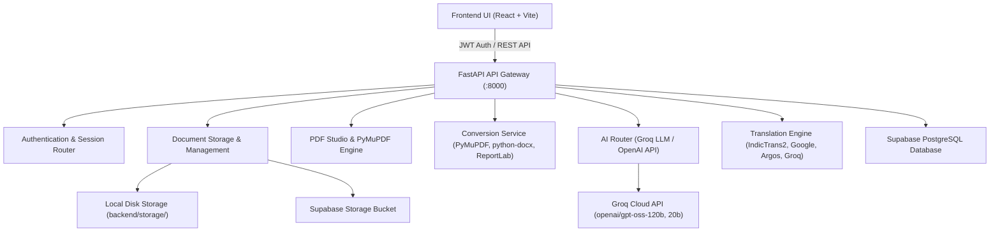

# Vertex Docs: Comprehensive Technical Architecture & Feature Guide

---

## 1. High-Level Technology Stack Overview

### Frontend Architecture
* **Framework**: React 19 + TypeScript (Strict Type Checking)
* **Build Tool & Bundler**: Vite 8.3
* **Styling**: Pure Modern CSS with CSS Variables, theme definitions (Light, Dark, Slate, Warm, Cool, Custom), flexbox/grid responsive layouts.
* **Icons**: `lucide-react` (high performance vector SVG icons).
* **State Management**: React state hooks (`useState`, `useRef`, `useEffect`, `useCallback`) with custom persistent storage.
* **Client Networking**: Custom API client wrapper (`fetch` API with automatic Bearer token injection, multipart form-data support, and streaming SSE parser).

### Backend Architecture
* **Core API Framework**: FastAPI (Python 3.12, ASGI-based asynchronous microframework).
* **ASGI Server**: Uvicorn (HTTP/1.1 & WebSocket support).
* **ORM & Database Toolkit**: SQLAlchemy 2.0 (declarative ORM) + Alembic for migrations.
* **Database Engine**: PostgreSQL via Psycopg 3 (`psycopg` binary driver) hosted on **Supabase Database Pooler** (fallback support for SQLite for offline/isolated usage).
* **Authentication & Security**: Passlib (Bcrypt password hashing) + Python-Jose / PyJWT (JWT tokens with expiration and Bearer authorization headers).
* **Storage Layer**: Dual-tier storage (Local workspace disk storage at `backend/storage/` + Supabase Cloud Storage bucket `user-documents`).
* **HTTP Client**: `httpx` (async HTTP/2-capable client for outbound LLM and translation requests).

---

## 2. End-to-End Workflow Architecture

1. **Authentication Flow**: Users register or log in via `/api/auth/register` or `/api/auth/login`. Passwords are encrypted with `bcrypt`. An access token (JWT) is returned and stored in local state/storage.
2. **File Processing Flow**: When a document is dropped into any workspace or tool:
   - Uploaded through `/api/documents/upload` or dedicated endpoint.
   - Preserved in `backend/storage/` with UUID-based collision resistance.
   - Metadata is committed to the PostgreSQL `documents` table.
3. **AI Task Flow**: The document text is extracted on the fly (via PyMuPDF for PDFs, python-docx for Word, openpyxl for Excel, python-pptx for PowerPoint, or clean text readers).
4. **Result Delivery Flow**: Responses are either returned as JSON (summaries, chat messages) or binary files (PDF downloads, DOCX exports).

---

## 3. PDF Studio: Features & Technical Implementation

PDF Studio is a suite of in-browser and server-backed PDF manipulation tools:

| Feature | Behind-the-Scenes Technology | How It Works |
| :--- | :--- | :--- |
| **Merge PDF** | `pypdf` (`PdfWriter`, `PdfReader`) | Reads multiple input PDFs, sequences pages in memory, and writes a unified PDF document. |
| **Split PDF (By Pages, Range, Size)** | `pypdf` + `pymupdf` | Splits document streams into individual or chunked page streams; packages multiple outputs into a ZIP archive if needed. |
| **Rotate PDF** | `pypdf` page transformation | Rotates page orientation clockwise by 90, 180, or 270 degrees in the PDF metadata matrix. |
| **Compress PDF** | `pymupdf` (deflate compression) | Removes duplicate streams, flattens unused font subsets, and compresses embedded images. |
| **Protect / Unlock PDF** | `pypdf` RC4/AES 128/256-bit encryption | Encrypts PDF with user/owner password or decrypts protected files. |
| **PDF Annotator & Canvas** | HTML5 Canvas + `PdfAnnotator.tsx` | Allows freehand drawing, highlighting, text stamps, and rectangular highlights directly on the rendered page. |
| **Blank PDF Editor & Rich Text** | ReportLab + `BlankPdfEditor.tsx` | Full WYSIWYG text editor that converts HTML content blocks into A4/Letter vector PDF documents. |
| **Watermark & Page Numbers** | `reportlab` overlay canvas | Generates dynamic transparent text watermark overlays and stamps page counters at coordinates `(x, y)`. |
| **Compare PDF** | `pymupdf` page-by-page text diffing | Extracts words and text blocks from two separate PDFs, compares line-by-line differences, and produces a structured change report with multi-file insertion. |
| **Bates Numbering** | `reportlab` text stamp | Stamps legal-grade sequential Bates numbering prefixes (`CASE-000001`, etc.) across pages. |
| **PDF to Images / Extract Images** | `pymupdf` (`get_pixmap()`) | Renders pages as high-resolution PNG/JPEG images or extracts embedded raster bitmaps. |

---

## 4. Conversion Engine: Supported Types & Implementation

### How Conversions Work
The conversion engine is located in `conversion_service.py` and uses native Python vector and parsing libraries without requiring external office runtimes:

* **Text-to-PDF / Markdown-to-PDF**: Uses `ReportLab` with custom styles, flowable paragraphs, and Unicode TrueType font support.
* **Word (DOCX) to PDF**: Parsed with `python-docx` into structured elements and typeset with `ReportLab`.
* **Excel (XLSX) to PDF**: Parsed with `openpyxl`, calculating column widths and generating clean vector tables.
* **PowerPoint (PPTX) to PDF**: Parsed with `python-pptx`, creating slide-by-slide visual layout representations.
* **Images (JPG, PNG, WebP) to PDF**: Pillow (`PIL.Image`) converts images into standard PDF page dimensions with DPI scaling.
* **PDF to Word (DOCX)**: PyMuPDF extracts text blocks and font heuristics, reconstructed into paragraphs and tables via `python-docx`.
* **PDF to Excel (XLSX)**: Detects table boundaries and delimiters, writing rows into `openpyxl` sheets.
* **PDF to Text / Markdown**: Text extraction with layout preservation via PyMuPDF.
* **ZIP to PDF**: Unpacks multi-document archives (up to 200 files / 200 MB), converts each constituent file into PDF, and concatenates them into a single PDF output.

---

## 5. AI Documents & Intelligence

### What LLM & API Is Used
* **Provider**: **Groq Cloud API** (`https://api.groq.com/openai/v1`).
* **Active Models**: `openai/gpt-oss-120b` (primary high-speed reasoning model) and `openai/gpt-oss-20b` (fast fallback model).
* **API Key**: Loaded dynamically from `backend/.env` via `LLM_API_KEY`.
* **Integration**: Standard OpenAI-compatible Chat Completions API with fallback retry mechanisms and streaming response capabilities.

### Key AI Features:
1. **AI PDF Summarizer**:
   - Computes extractive passage importance combined with generative summarization.
   - Supports length budgets: *Short* (~600 chars), *Medium*, and *Detailed* (~3,500 chars).
   - **Multi-Language Summaries**: When a target language (like Tamil, Telugu, Hindi, Spanish, French, etc.) is picked, the engine automatically formats the complete summary in that specific language.
2. **Ask Your Document (Doc Chat)**:
   - Uses RAG (Retrieval-Augmented Generation) with semantic chunking to find the most relevant sections of the document.
   - Enforces strict language compliance so all conversational answers are delivered strictly in the selected language.
3. **AI Question Generator**:
   - Analyzes document content to generate tailored study/quiz questions with matching answer keys in the chosen language.
4. **Humanizer**:
   - Rewrites stiff, machine-sounding, or AI-generated prose into natural, engaging human writing.
   - Supports 4 distinct tones (*Simple*, *Professional*, *Conversational*, *Academic*) across 5 intensity levels.
   - Includes local fallback algorithms to humanize text without relying on external network requests.

---

## 6. Language Bridge & Translation Engine

### Priority & Fallback Architecture
The translation system (`translation_engine.py`) operates with an ordered provider chain:
1. **IndicTrans2**: Dedicated neural translation service for Indian languages (`INDICTRANS_URL`).
2. **Google Cloud Translation API**: If `GOOGLE_TRANSLATE_API_KEY` is provided.
3. **Argos Translate**: Local offline neural translation packages (`argostranslate`).
4. **Groq LLM Fallback**: High-speed translation using our primary LLM provider.

### Supported Languages:
* **English (`en`)**
* **Tamil (`ta`)**
* **Telugu (`te`)**
* **Hindi (`hi`)**
* **Malayalam (`ml`)**
* **Kannada (`kn`)**
* **Bengali (`bn`)**
* **Sanskrit (`sa`)**
* **Japanese (`ja`)**
* **German (`de`)**
* **French (`fr`)**
* **Spanish (`es`)**
* **Tanglish (`tanglish`)**: Romanized Tamil (spoken Tamil in Latin alphabet, e.g. *"naeram enpathu engkal vaazhkkaiyil..."*).

---

## 7. Why Supabase?

1. **Managed PostgreSQL Database**: Provides a scalable relational database with connection pooling (`pooler.supabase.com:5432`).
2. **User & Document Association**: Stores user records, metadata, shared documents, signature requests, activity audit logs, and annotation states.
3. **Hybrid Storage Redundancy**: Configured with dual-tier storage: files are immediately written locally to ensure zero downtime, while cloud uploads sync to Supabase Storage (`user-documents`).

---

## 8. Vertex AI Assistant (Chatbot)

* **Architecture**: Located in `backend/app/chatbot/`.
* **Features**:
  * Persistent conversations with conversation history.
  * Direct file attachments: Users can attach PDFs, images, or docs directly inside the chat.
  * Intent-driven actions: Automatically detects commands like "convert this to docx" or "translate this to Tamil" and outputs interactive **Download Cards**.
  * Markdown & Code rendering with clipboard copy shortcuts.

---

## 9. Admin Dashboard & Operations

* **Admin Role Verification**: Secured by role-based access control (`user.role == "admin"`).
* **System Metrics**:
  * Total registered users & document volume.
  * Storage breakdown and total system payload.
  * Live activity audit log showing user actions (uploads, conversions, summaries, translations).
  * System health check across database, storage, and translation providers.

---

## 10. Verification & System Health Checklist

| Component | Status | Verification Check |
| :--- | :--- | :--- |
| **Backend API** |  Active | `http://localhost:8000/docs` (Swagger UI responsive) |
| **Frontend Web** |  Active | `http://localhost:5173` (Vite dev server) |
| **Database** |  Active | PostgreSQL connected & tables verified |
| **Storage Engine** |  Active | Local disk storage (`backend/storage/`) fallback active |
| **Groq AI Provider**|  Active | Validated with `openai/gpt-oss-120b` |
| **OCR Service** |  Active | Direct-layer extractor active for all documents |
| **Tanglish Engine** |  Active | Full script transliteration verified |
| **Language Bridge** |  Active | Multi-language translation & reverse translation verified |
